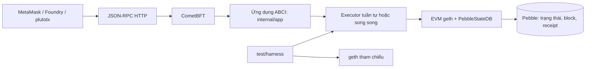

# Báo cáo cấu trúc và chức năng các thư mục, tệp của Pluto

## 1. Mục đích của báo cáo

Tài liệu này giải thích dự án Pluto theo cách lần theo được từ lúc node khởi động, nhận giao dịch, thực thi EVM, cập nhật trạng thái, cho đến lúc kiểm thử và đo hiệu năng. Trọng tâm là các phần M1 (engine tuần tự), M3 (bộ kiểm thử đối chiếu) và M4 (engine song song); phần checkpoint M5 cũng được mô tả vì nó nằm trong đường thực thi song song hiện nay.

Đây là hướng dẫn đọc mã nguồn, không phải khẳng định rằng dự án đã tương thích hoàn toàn với Ethereum hoặc đã sẵn sàng làm mạng sản xuất. Chức năng thật cần được đánh giá theo mã, phạm vi test, cấu hình node và kết quả benchmark.

## 2. Pluto nhìn từ trên cao

Pluto là một ứng dụng blockchain viết bằng Go. CometBFT quản lý giao thức block và đồng thuận; ứng dụng Pluto nhận các lệnh gọi ABCI để kiểm tra và thực thi giao dịch. Phần thực thi hợp đồng dùng EVM của go-ethereum. Pebble lưu dữ liệu trạng thái và dữ liệu block. Cổng Ethereum JSON-RPC giúp công cụ như MetaMask hoặc Foundry gửi truy vấn/giao dịch theo một tập phương thức Ethereum mà Pluto hỗ trợ.



Harness trong `test/harness` tạo cơ sở dữ liệu và workload dùng riêng cho test. Những giao dịch benchmark này không tự gửi vào node đang chạy và không làm thay đổi số dư ví MetaMask.

## 3. Cây thư mục chính

| Thư mục | Vai trò |
|---|---|
| `cmd/` | Các chương trình có thể chạy: node `plutod`, công cụ giao dịch `plutotx`, demo checkpoint. |
| `contracts/` | Hợp đồng Solidity mẫu và bytecode đã biên dịch dùng khi triển khai/test. |
| `design/` | Tài liệu thiết kế engine song song P/O/S. |
| `docs/` | Hướng dẫn người dùng và báo cáo kỹ thuật. |
| `internal/app/` | Ứng dụng ABCI: nối CometBFT với EVM, xử lý block, truy vấn trạng thái, kiểm tra giao dịch và lưu dữ liệu Ethereum. |
| `internal/config/` | Các tham số cấu hình dùng chung như chain ID và địa chỉ RPC. |
| `internal/ethrpc/` | Máy chủ và các phương thức JSON-RPC Ethereum. |
| `internal/evm/` | StateDB, engine tuần tự/song song, EVM runner, checkpoint và metric. |
| `internal/store/` | Lớp bọc PebbleDB theo giao diện lưu trữ CometBFT. |
| `scripts/` | Script hỗ trợ chạy kịch bản end-to-end. |
| `test/harness/` | Đối chiếu với geth, workload, fuzz, mutation test và benchmark. |
| `test/spike/` | Các thử nghiệm nhỏ dùng để đánh giá hướng thiết kế checkpoint M5.1. |

## 4. Luồng xử lý một giao dịch trên node

1. `cmd/plutod/main.go` tạo CometBFT node, ứng dụng Pluto, Pebble và máy chủ JSON-RPC. Cờ `--executor` chọn `sequential` hoặc `parallel`; `--workers` cấu hình số worker khi chọn song song.
2. Ví/công cụ gửi giao dịch có chữ ký đến `eth_sendRawTransaction` trong `internal/ethrpc/api.go`.
3. JSON-RPC phát giao dịch vào CometBFT. `CheckTx` trong ứng dụng kiểm tra giao dịch trước khi đưa vào hàng chờ.
4. CometBFT đề xuất và thống nhất block. Ứng dụng nhận block ở `FinalizeBlock` trong `internal/app/app.go`.
5. `FinalizeBlock` chọn executor. Executor gọi geth EVM và đọc/ghi qua `PebbleStateDB`.
6. Kết quả giao dịch, receipts, logs, block metadata và trạng thái được chuẩn bị. `Commit` lưu dữ liệu theo batch để node có thể khôi phục sau khi khởi động lại.
7. Các phương thức JSON-RPC đọc lại số dư, nonce, code, block, receipt hoặc chạy `eth_call`/`eth_estimateGas`.

## 5. Từng tệp ở thư mục gốc

| Tệp | Chức năng |
|---|---|
| `go.mod` | Tên module Go, phiên bản Go và các thư viện chính. Những thư viện đáng chú ý: CometBFT, go-ethereum và Pebble. |
| `go.sum` | Khóa checksum của các phiên bản thư viện để Go tải và xác minh dependency nhất quán. |
| `foundry.toml` | Cấu hình Foundry dùng biên dịch/test hợp đồng Solidity. |
| `CHECKPOINT_DEMO.md` | Hướng dẫn chạy demo checkpoint M5 và giải thích cách đọc trace. |
| `checkpoint-metrics.csv` | Một bản xuất metric P0–P3 đã ghi ra CSV. Đây là dữ liệu của một lượt chạy cụ thể, không phải kết quả benchmark phổ quát. |
| `REMIX.md` | Ghi chú hướng dẫn làm việc với Remix và hợp đồng. |
| `quantum_cryptography.md` | Tài liệu nghiên cứu mật mã lượng tử. Đây là tài liệu tham khảo; không có nghĩa thuật toán lượng tử đang được dùng trong đường xử lý giao dịch của node. |

## 6. Chương trình có thể chạy: `cmd/`

### `cmd/plutod/main.go`

Điểm bắt đầu của chương trình node. Tệp này đọc `--home`, `--executor`, `--workers`; chuẩn bị thư mục dữ liệu, tải/tạo khóa node và validator của CometBFT, tạo ứng dụng ABCI, mở node, rồi mở Ethereum JSON-RPC. Đây là tệp nên đọc đầu tiên để biết lệnh chạy node khởi tạo những thành phần nào.

### `cmd/plutotx/main.go`

Công cụ dòng lệnh để đọc số dư/nonce, ký và gửi giao dịch, deploy hợp đồng, gọi contract và đọc storage. Công cụ này dùng key do người dùng cung cấp; khóa validator CometBFT không phải khóa tài khoản Ethereum.

### `cmd/checkpointdemo/main.go`

Chạy một workload Counter nhỏ trực tiếp qua `ParallelExecutor` với các chính sách checkpoint. Nó in trace và metric để quan sát việc chạy lại từ đầu hoặc resume. Demo này không chạy node, không mở RPC và không ghi giao dịch lên chain đang chạy.

## 7. Hợp đồng mẫu: `contracts/`

| Tệp | Chức năng |
|---|---|
| `Counter.sol` | Hợp đồng đếm đơn giản, dùng kiểm tra deploy, gọi hàm và xung đột khi nhiều giao dịch cập nhật cùng storage. |
| `Counter.bin` | Bytecode đã biên dịch của Counter; công cụ deploy/test có thể dùng bytecode mà không cần biên dịch Solidity ở mỗi lần chạy. |
| `Token.sol` | ERC-20 tối giản để minh họa tổng cung, số dư và `transfer`. Đây là token hợp đồng, khác coin gốc của chain. |
| `Token.bin` | Bytecode đã biên dịch của Token. |
| `SimpleAMM.sol` | Hợp đồng AMM mẫu dùng minh họa swap và cập nhật trạng thái pool. |

## 8. Ứng dụng blockchain: `internal/app/`

| Tệp | Chức năng |
|---|---|
| `app.go` | Trung tâm ABCI. Khởi tạo genesis, cung cấp `Info`, xử lý proposal, `CheckTx`, `FinalizeBlock`, `Commit`, truy vấn và cấu hình executor. Để hiểu đường đi của giao dịch trong node, tập trung vào `CheckTx`, `FinalizeBlock`, `Commit`. |
| `handlers.go` | Các hàm hỗ trợ chuyển giao dịch thành thông điệp EVM, kiểm tra/xử lý giao dịch và nối ngữ nghĩa giao dịch Ethereum với state của ứng dụng. Đọc cùng `app.go` và `executor.go`. |
| `call.go` | Đầu vào và logic ứng dụng cho các lệnh gọi chỉ đọc như `eth_call` và ước lượng gas; không nên làm thay đổi state bền vững. |
| `read.go` | Các hàm đọc tài khoản, số dư, nonce, code và storage từ trạng thái Pluto. |
| `ethereum_store.go` | Kiểu dữ liệu và thao tác lưu/đọc block, giao dịch, receipt, logs và vị trí giao dịch để phục vụ JSON-RPC. |
| `checktx_test.go` | Kiểm tra giao dịch hợp lệ được chấp nhận và các giao dịch sai bị từ chối ở `CheckTx`. |
| `executor_config_test.go` | Kiểm tra chỉ chấp nhận executor đã biết và số worker dương. |
| `executor_test.go` | Test engine tuần tự, deploy/call contract, gas, revert, state root, lưu block/receipt và khôi phục state sau restart. |
| `parallel_executor_test.go` | Kiểm tra tích hợp executor song song với commit của ứng dụng ở một số workload. |
| `call_test.go` | Kiểm tra gọi/ước lượng gas chỉ đọc không ghi state và xử lý trường hợp revert. |

## 9. EVM, state và engine: `internal/evm/`

### Nền tảng thực thi và trạng thái

| Tệp | Chức năng |
|---|---|
| `executor.go` | Định nghĩa `Executor`, `StateReader`, `BlockEnv`, kết quả giao dịch/block và `SequentialExecutor`. Engine tuần tự là chuẩn để đối chiếu; nó chạy giao dịch theo thứ tự bằng `core.ApplyMessage`. |
| `vm_runner.go` | Chuẩn bị EVM và ngữ cảnh block/giao dịch cho việc thực thi. Các đầu vào block như chiều cao, thời gian, coinbase, gas limit, randomness và block hash cần tất định giữa các validator. |
| `state.go` | `PebbleStateDB`, phần cài đặt `vm.StateDB` cho EVM. Quản lý balance, nonce, code, storage, snapshot/journal, logs, refund, state root và ghi thay đổi xuống Pebble. |
| `state_overlay.go` | Tạo overlay/fork trạng thái riêng cho một giao dịch, rồi áp dụng các thay đổi đã được chấp nhận vào state chuẩn. |
| `call.go` | Thực hiện EVM call chỉ đọc phục vụ `eth_call` và `eth_estimateGas`. |
| `decoder.go` | Chuyển dữ liệu giao dịch thô thành giao dịch Ethereum mà engine có thể thực thi. |

### Thực thi song song M4

| Tệp | Chức năng |
|---|---|
| `parallel_executor.go` | Định nghĩa `ParallelExecutor`, `TxState`, khóa phiên bản `MVKey`/`MVMemory`, lớp ghi nhận read/write set và đường song song nhanh cho giao dịch chuyển EOA độc lập đủ điều kiện. |
| `optimistic_attempt.go` | Chạy các giao dịch đầu cơ trên overlay theo nhóm worker, ghi nhận kết quả và xung đột; resolver xác thực/chấp nhận theo thứ tự giao dịch chuẩn hoặc yêu cầu retry. |

Ở đường tổng quát, worker không ghi trực tiếp vào state chuẩn. Thứ tự hoàn tất của goroutine không quyết định thứ tự block. Kết quả dựa trên dữ liệu cũ bị loại bỏ và chạy lại. Đường S tối ưu riêng có điều kiện chặt; không nên mô tả thành mọi giao dịch EVM đều có đường tăng tốc.

### Checkpoint M5

| Tệp | Chức năng |
|---|---|
| `checkpoint.go` | Khai báo các chính sách P0, P1, P2, P3; chọn vị trí checkpoint theo opcode, lần đọc hoặc khóa nóng; lưu/khôi phục trạng thái interpreter và overlay. |
| `checkpoint_capture.go` | Quan sát opcode và sự kiện đọc trạng thái để tạo checkpoint trước vị trí có thể cần khôi phục. |
| `checkpoint_recovery.go` | Khi validation thất bại, tìm checkpoint hợp lệ gần nhất trước lần đọc lỗi; nếu không dùng được thì chạy lại từ đầu theo đường an toàn. |
| `resume_attempt.go` | Tiếp tục một attempt đã lưu từ trạng thái checkpoint và hoàn tất phần xử lý message/gas. |
| `geth_resume.go` | Cầu nối để tiếp tục EVM geth từ interpreter/call frame được chụp; điểm quan trọng vì Pluto phải giữ ngữ nghĩa EVM thay vì viết một EVM thay thế. |
| `checkpoint_metrics.go` | Cấu trúc và xuất metric checkpoint như số checkpoint, số lần dùng lại, retry, fallback, opcode chạy lại và ước tính bộ nhớ. |
| `checkpoint_test.go` | Kiểm tra snapshot/restore và hành vi chính sách checkpoint cơ bản. |
| `checkpoint_policy_test.go` | Kiểm tra chính sách chọn đúng vị trí checkpoint và từ chối cấu hình sai. |
| `checkpoint_recovery_test.go` | Kiểm tra phục hồi, fallback an toàn, không commit delta đã hủy và giới hạn retry. |
| `checkpoint_metrics_test.go` | Kiểm tra header CSV ổn định và ước tính phần dữ liệu checkpoint sở hữu. |
| `production_resume_test.go` | Kiểm tra resume với EVM production và đối chiếu kết quả với tuần tự ở một số ca như nested call, revert, out-of-gas, logs. |
| `state_overlay_test.go` | Kiểm tra overlay cô lập, version tracking, read/write set và attempt đầu cơ. |
| `state_test.go` | Kiểm tra committed/origin storage, snapshot, refund, journal và dọn state giao dịch. |

Checkpoint giúp tránh chạy lại một phần opcode sau xung đột, nhưng tạo chi phí chụp và giữ snapshot. Vì thế, giảm số opcode chạy lại không tự động đồng nghĩa tổng thời gian block giảm.

## 10. Lưu trữ: `internal/store/pebble.go`

Đóng gói PebbleDB sau giao diện database mà CometBFT cần. Tệp này cung cấp đọc/ghi/xóa, batch, iterator, compact và đóng database. EVM state và metadata blockchain đi qua các lớp trên của ứng dụng; `pebble.go` là tầng lưu key/value, không phải logic hợp đồng.

## 11. Ethereum JSON-RPC: `internal/ethrpc/`

| Tệp | Chức năng |
|---|---|
| `server.go` | Tạo máy chủ HTTP JSON-RPC, đăng ký nhóm `eth`, `net`, `web3`, bật CORS và quản lý vòng đời server. |
| `api.go` | Cài đặt các phương thức JSON-RPC như chain ID, block number, balance, nonce, code, storage, block/transaction/receipt, gửi giao dịch thô, `eth_call` và `eth_estimateGas`. Đây là một tập phương thức tương thích cần thiết cho công cụ ví, không có nghĩa mọi Ethereum RPC đều đã được triển khai. |
| `server_test.go` | Kiểm tra HTTP RPC, các phương thức đọc, từ chối block ngoài head, giao dịch bị CheckTx từ chối, CORS, receipt và persistence sau restart. |

## 12. Harness, test và benchmark: `test/harness/`

| Tệp | Chức năng |
|---|---|
| `README.md` | Hướng dẫn các lệnh chạy differential test, fuzz, benchmark, ma trận checkpoint và báo cáo dễ đọc. |
| `differential_harness_test.go` | Bộ so sánh chính: khởi tạo state test, chạy Pluto/geth, thu thập quan sát, tìm kết quả đầu tiên bị lệch. |
| `differential_workloads_test.go` | Sinh workload deterministic cho chuyển tiền, Counter, ERC-20, AMM, nested call, revert/out-of-gas, fuzz và workload 10.000 giao dịch. |
| `differential_benchmark_test.go` | Benchmark workload và so tuần tự với song song ở nhiều số giao dịch/worker. |
| `comparison_report_test.go` | In báo cáo dễ đọc gồm trung vị thời gian, chênh lệch, speedup, cấp phát, độ ổn định và kiểm tra đúng đắn. Phép đo chỉ tính `ExecuteBlock`. |
| `checkpoint_metrics_benchmark_test.go` | Chạy các policy checkpoint trên workload xác định, xuất CSV và benchmark các metric liên quan. |
| `mutation_test.go` | Cố tình tạo executor sai để xác nhận harness phát hiện kết quả sai; lỗi mutation chỉ tồn tại trong test. |

Các đối chiếu với geth kiểm tra kết quả và trạng thái quan sát được. Root của geth và AppHash riêng của Pluto có định dạng/cách tính khác nhau nên không thể so byte-for-byte như cùng một loại root. Các test chỉ chứng minh workload đã chạy qua; chúng không bao phủ hết mọi opcode, fork hoặc hành vi EVM.

## 13. Spike thiết kế checkpoint: `test/spike/`

Spike là mã thử nghiệm phục vụ quyết định thiết kế; không nhầm tất cả file trong đây với đường chạy node production.

| Tệp | Chức năng |
|---|---|
| `M5.1-DECISION.md` | Ghi quyết định kỹ thuật về hướng checkpoint và ưu/nhược điểm các phương án. |
| `gethfork/interpreter.go` | Bản thử nghiệm vòng lặp interpreter fork để đánh giá resume giữa opcode. |
| `gethfork/interpreter_test.go` | Test kết quả spike so với chạy liên tục/geth và quyền sở hữu dữ liệu snapshot. |
| `gethfork/README.md` | Giới hạn và cách chạy spike interpreter fork. |
| `callframe/checkpoint.go` | Spike checkpoint tại ranh giới call frame. |
| `callframe/checkpoint_test.go` | Test khôi phục rồi replay frame lồng nhau; ghi nhận giới hạn không resume chính xác giữa frame đang chạy. |
| `callframe/README.md` | Tóm tắt phạm vi spike call-frame. |
| `minivm/minivm.go` | EVM tối giản thử checkpoint trên tập opcode rất nhỏ; không phải EVM production của Pluto. |
| `minivm/minivm_test.go` | So kết quả mini VM với thực thi mẫu/geth và xác nhận giới hạn opcode. |
| `minivm/README.md` | Giải thích mục đích và phạm vi mini VM. |

## 14. Hướng dẫn và cấu hình ngoài mã nguồn

| Tệp | Chức năng |
|---|---|
| `docs/foundry-e2e.md` | Các bước chạy kiểm thử end-to-end với Foundry/RPC. |
| `scripts/foundry-e2e.ps1` | Script PowerShell tự động hóa một phần kịch bản Foundry. |
| `.github/workflows/ci.yml` | CI build, vet, test, race detector và fuzz smoke test trên các nhánh được workflow cấu hình. |
| `.gitignore` | Quy định các tệp không đưa vào Git, gồm dữ liệu sinh ra hoặc cấu hình môi trường cục bộ. |

Thư mục `.pluto-home` chứa dữ liệu node cục bộ, có thể gồm private validator key và database. Đây không phải mã nguồn để chia sẻ trong báo cáo; tuyệt đối không công khai khóa bí mật. `.diag-go-cache` là cache chẩn đoán cục bộ, không phải thành phần blockchain.

## 15. Cách trình bày M1, M3, M4 khi bảo vệ

- **M1 – mốc tuần tự:** ứng dụng ABCI nối CometBFT với EVM geth; `PebbleStateDB` lưu trạng thái; `SequentialExecutor` thực thi theo thứ tự block. Đây là cơ sở để kiểm tra kết quả và làm chuẩn cho song song.
- **M3 – kiểm chứng:** workload có seed tái lập được chạy qua Pluto và geth; harness so status, gas, logs, balances, nonce, code, storage và root nội bộ Pluto. Fuzz và mutation giúp tìm lỗi và xác nhận bộ so sánh có thể bắt một số lỗi được cài có chủ đích.
- **M4 – thực thi đồng thời có kiểm tra:** worker chạy attempt trên overlay; `MVMemory`/read-write set phát hiện phụ thuộc; resolver chốt theo thứ tự giao dịch và retry kết quả cũ. Tăng worker không đảm bảo tăng tốc; chỉ benchmark cùng workload mới cho biết hiệu quả.
- **M5 – tiếp tục sau xung đột:** checkpoint P0–P3 thử giảm phần thực thi lặp lại. Đây là tối ưu trong executor song song, không phải thay đổi coin/token hay một giao dịch thật của người dùng.

Một cách nói chính xác là: “Dự án đã xây và kiểm thử engine tuần tự, harness đối chiếu, và executor song song đầu cơ với checkpoint. Kết quả benchmark chỉ áp dụng cho workload, cấu hình và máy đã đo; dự án chưa chứng minh toàn bộ EVM luôn nhanh hơn hoặc mọi chức năng RPC của Ethereum đều được hỗ trợ.”

## 16. Lệnh xem các báo cáo kiểm thử

Các lệnh sau chỉ chạy test/benchmark cục bộ, không gửi giao dịch lên node:

```powershell
go test ./... -count=1
go build ./...
go test ./test/harness -run '^TestSequentialParallelPerformanceReport$' -count=1 -v
```

Để chạy node song song, đó là một thao tác riêng:

```powershell
go run ./cmd/plutod --home .\.pluto-home --executor=parallel --workers=4
```

Phép đo harness không thay thế việc kiểm thử node/RPC end-to-end. Khi trình bày kết quả, hãy nói rõ bạn đang đưa ra kết quả test engine, benchmark executor hay demo giao dịch trên node.
