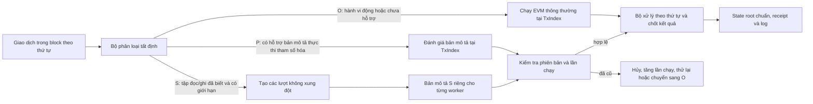

# Thiết kế thực thi giao dịch song song P/O/S của Pluto

## Mục tiêu và nguyên tắc đúng

Pluto thực thi các giao dịch trong một block theo đúng thứ tự đã được đề xuất. Các worker song song có thể tính trước kết quả dự kiến, nhưng chỉ bộ xử lý theo thứ tự mới được chấp nhận thay đổi trạng thái. Với mỗi block đầu vào, kết quả quan sát được của từng giao dịch và state root cuối cùng của Pluto phải giống với `SequentialExecutor`. Engine tuần tự tiếp tục là mốc tham chiếu và là lựa chọn mặc định của node cho đến khi kiểm thử đối chiếu và benchmark đủ cơ sở để thay đổi.

Thiết kế này theo mô hình P/O/S trong `pluto2_final_clean.docx` và sử dụng một số ý tưởng của Block-STM như thực thi dự đoán có phiên bản và kiểm tra lại kết quả. Hai mô hình bổ trợ cho nhau: P/O/S quyết định cách thực thi nào an toàn; quản lý phiên bản, lần chạy, kiểm tra hợp lệ và chốt kết quả theo thứ tự là cách hiện thực chiến lược đó.

## Các loại giao dịch P/O/S

* **S (tĩnh):** bộ phân tích có thể chứng minh trước tập đọc/ghi có giới hạn. Các giao dịch có tập đọc/ghi không giao nhau có thể chạy trong cùng một lượt. Bản triển khai đầu tiên chỉ hỗ trợ giao dịch chuyển giá trị EOA dạng legacy thông thường: calldata rỗng, gas đúng bằng mức cơ bản của giao dịch chuyển tiền, gas price bằng 0, người gửi và người nhận không phải hợp đồng, đồng thời địa chỉ nhận không phải precompile. Mô hình này theo dõi số dư và nonce của người gửi cùng số dư của người nhận. Nếu còn điểm nào chưa chắc chắn thì giao dịch không được xếp loại S.
* **P (tham số hóa):** bộ phân tích có thể tạo ra một bản mô tả thực thi tất định, gồm điều kiện kiểm tra, đầu ra phụ thuộc trạng thái, ảnh hưởng đến gas/receipt và chứng nhận. Bộ xử lý theo thứ tự kiểm tra điều kiện trên trạng thái chính xác tại `TxIndex`; nếu điều kiện đúng, nó áp dụng bản mô tả mà không cần chạy lại bytecode. Chưa chấp nhận bản mô tả P nào cho đến khi ngữ nghĩa và kiểm thử đối chiếu được hoàn thiện. Chỉ có đề xuất hoặc access list thì chưa đủ để chứng minh an toàn.
* **O (không phân tích được):** tạo hợp đồng, gọi hợp đồng thông thường, đích `CALL` động, truy cập storage chưa biết, opcode chưa hỗ trợ hoặc vượt giới hạn phân tích. Các giao dịch này chạy bằng EVM thông thường trên overlay riêng; bộ phân giải vẫn nhận kết quả theo thứ tự block và chạy lại giao dịch nếu dữ liệu đọc đã cũ. O là đường EVM tổng quát, không có nghĩa là từ chối giao dịch.

Việc phân loại phải cho cùng kết quả trên mọi validator. Hãy dùng giới hạn số lệnh và số bước duyệt CFG; không dùng thời gian thực để quyết định. Không được xem access list EIP-2930 như một khai báo bắt buộc về mọi vùng trạng thái mà giao dịch sẽ truy cập. Thứ tự giao dịch trong block, quy tắc nonce, phí, hành vi revert, log và cách tính gas vẫn là các đầu vào của giao thức.

## Trạng thái, phiên bản và các lần thực thi giao dịch

Mỗi lần thực thi EVM dùng một bản fork `TxState` độc lập. Các lần đọc lấy từ trạng thái bất biến tại thời điểm bắt đầu lượt; các lần ghi, nhật ký thay đổi, bộ đếm hoàn gas, transient storage, access list và log được giữ riêng. Bản mô tả chuyển tiền S hiện tại được tính từ bản sao dữ liệu tài khoản, không sửa EVM StateDB dùng chung trên worker. `ReadSet` lưu khóa và phiên bản đã đọc; `WriteSet` lưu giá trị cuối cùng hoặc thao tác xóa. Các khóa phân biệt số dư tài khoản, nonce, code/sự tồn tại của tài khoản và từng storage slot. Một lần thực thi giao dịch có cặp `(TxIndex, Incarnation)`; khi hủy, mọi bản mô tả và thay đổi ghi của lần chạy đó đều mất hiệu lực.

`MVMemory` lưu phiên bản mới nhất đã được chấp nhận cho từng khóa và cung cấp thao tác tra cứu phiên bản an toàn khi chạy đồng thời bằng cách chia shard. Scheduler tạo các lượt tất định, không xung đột, từ những tập S đã được chứng minh. Worker có thể hoàn tất không theo thứ tự, nhưng việc kiểm tra và chấp nhận luôn diễn ra theo `TxIndex`. Bước kiểm tra so sánh từng phiên bản đã đọc với phiên bản mới nhất có hiệu lực trước giao dịch đó. Nếu không khớp, kết quả lần chạy bị loại bỏ và giao dịch được chạy lại từ trạng thái mới tại cùng vị trí logic; nếu hành vi của giao dịch không thể mô hình hóa an toàn thì chuyển sang O.

Ảnh hưởng ở cấp giao thức và ảnh hưởng do EVM tạo ra phải được xử lý như geth. Cụ thể, giao dịch không hợp lệ không làm thay đổi trạng thái; giao dịch đã được đưa vào block nhưng EVM revert vẫn tiêu thụ nonce và gas, đồng thời giữ ảnh hưởng phí ở cấp giao thức trong khi hoàn tác thay đổi do thực thi hợp đồng. Gas pool được quản lý theo thứ tự block. Worker không được commit trực tiếp xuống Pebble.

## Xử lý theo thứ tự, lưu bền vững và số liệu

Bộ xử lý chấp nhận từng giao dịch theo thứ tự ban đầu, gộp `WriteSet` cuối cùng vào trạng thái chuẩn của block, sắp log và receipt theo `TxIndex`, rồi tính state root giống engine tuần tự. `FinalizeBlock` chỉ chuẩn bị bản đồ thay đổi cuối cùng. `Commit` hiện có vẫn là batch Pebble nguyên tử duy nhất để ghi trạng thái, chiều cao, app hash và block hash. Worker song song không ghi trực tiếp vào cơ sở dữ liệu.

Các metric dùng tên ổn định: `tx_total`, `tx_class_s`, `tx_class_p`, `tx_class_o`, `tx_parallel`, `worker_count`, `incarnation_total`, `abort_total`, `phase_analyze_ns`, `phase_execute_ns`, `phase_validate_ns`, `phase_resolve_ns`, `phase_commit_prepare_ns` và `phase_total_ns`. Ứng dụng ghi bản metric này một lần cho mỗi block. Thời gian chỉ phục vụ chẩn đoán và benchmark; không được dùng để phân loại giao dịch hoặc quyết định đồng thuận.

## Kế hoạch triển khai và chứng minh tính đúng

1. Giữ `SequentialExecutor` làm mốc chuẩn. Hoàn thiện thiết kế và interface trước khi thay đổi cách thực thi block.
2. Tạo `TxState` đọc xuyên từ state block bất biến và giữ các thay đổi riêng theo giao dịch. Worker chạy thử giao dịch trên các overlay; bộ phân giải xác thực theo `TxIndex`, hủy và chạy lại giao dịch khi tập đọc đã cũ. Đường S trực tiếp chỉ dùng cho block toàn giao dịch chuyển EOA đủ điều kiện; P vẫn tắt cho đến khi có artifact được chứng nhận.
3. So sánh mọi workload được hỗ trợ với Pluto tuần tự và geth bằng các giao dịch tất định đã ký của M3; đối chiếu trạng thái, gas, dữ liệu trả về, log, số dư, nonce, code, storage và state root của Pluto. Chạy `-race` cùng workload stress có seed cố định.
4. Benchmark tuần tự và song song trên cùng máy, phiên bản Go, seed, kích thước block, loại giao dịch, số worker và thời gian làm nóng. Báo cáo thông lượng, độ trễ, CPU, số lần hủy và tỷ lệ xung đột của workload. Không so benchmark Pluto chạy cục bộ với TPS được công bố của một blockchain khác.
5. Chỉ sau đó mới cung cấp `--executor=parallel --workers=N` dưới dạng tùy chọn. Tuần tự vẫn là mặc định cho đến khi kiểm thử đúng đắn rộng và mức cải thiện có thể lặp lại được chứng minh.

Bản triển khai đầu tiên này không có nghĩa là EVM đã chạy song song tổng quát. Counter, ERC-20, AMM, lời gọi lồng nhau, tạo hợp đồng và các giao dịch O khác vẫn chạy theo thứ tự cho đến khi có bản mô tả P an toàn hoặc chứng minh tĩnh rộng hơn.

## Tài liệu tham khảo

* Chi và cộng sự, [Block-STM: Scaling Blockchain Execution by Turning Ordering Curse to a Performance Blessing](https://arxiv.org/abs/2203.06871), 2022.
* Tài liệu thiết kế Pluto: `pluto2_final_clean.docx` (mô hình thực thi P/O/S).
